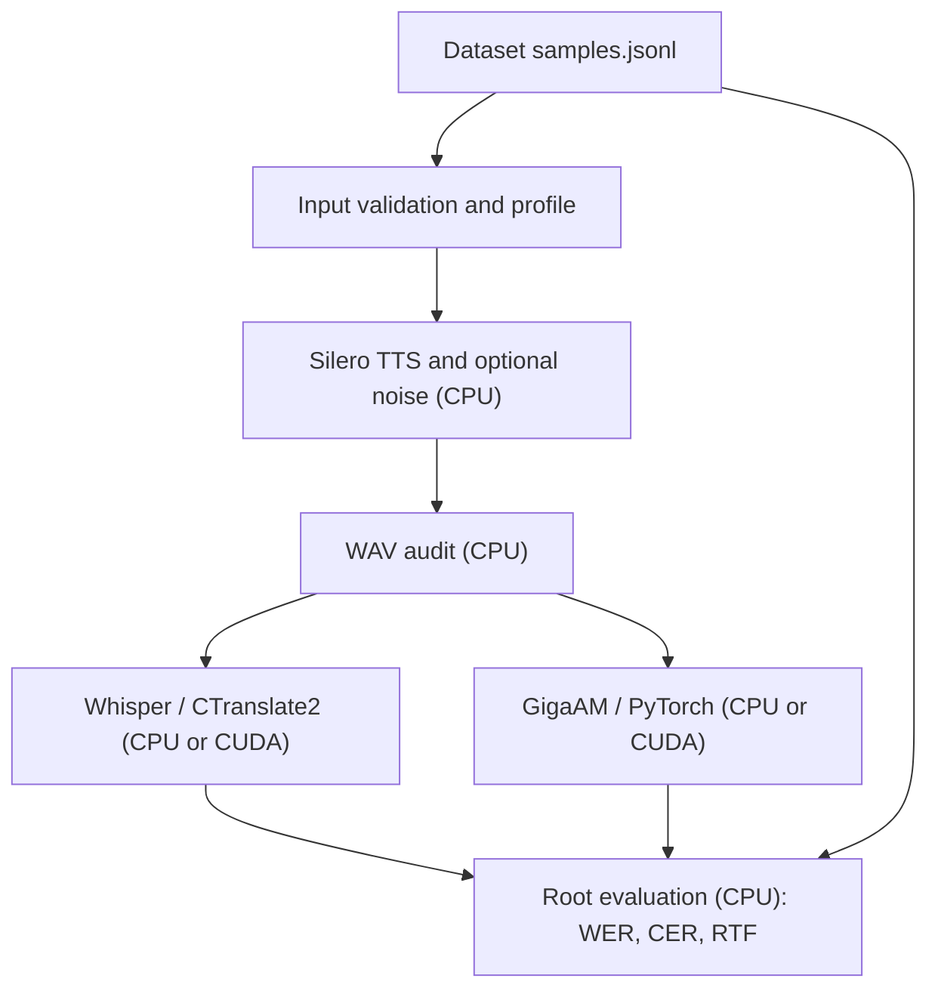

# TTS and ASR

Generate synthetic Russian speech, audit audio, transcribe identical WAV with
Whisper-small and GigaAM-v3 e2e_ctc, and evaluate the saved hypotheses. These are
pretrained inference models; this module does not train or fine-tune them.

## Architecture



Reference text enters TTS and the independent evaluator, never ASR prompts.
`action_id`, `args` and context are preserved as metadata, not recognition hints.
The pipeline stops on the first failed stage and preserves status/logs.
Audio loading and FFmpeg decoding run on CPU. The two ASR adapters run
sequentially, each in its configured environment. GPU profiles put ASR model
inference on the selected NVIDIA device.

## Limitations

- Review Latin and mixed-language tokens before synthesis. Russian Silero can
  reject standalone Latin words or omit them in mixed-language phrases.
- TTS input text is used unchanged here. `spoken_text_text_only.py` is an optional
  separate derivation policy; it is not applied by `run_pipeline.py` automatically.
- Synthesis accepts 0.2–30 s WAV; the GigaAM adapter accepts only 0–25 s.
  The pipeline has no shared pre-ASR duration gate: audit durations before calling
  either full ASR for a matched comparison. Long records are not trimmed automatically.
- Technical audit cannot establish spoken-word completeness. Human review is separate.
- The pipeline does not support resuming a run.
  A failed run remains on disk; use a new output directory for a rerun.

## Installation

Run from the repository root with Python 3.11. Each profile uses the indicated
environment for all stages by default. Install the PyTorch wheels for that
environment first, then install the shared [requirements.txt](requirements.txt).
Choose a fresh environment path if you already use one of the names below.

### CPU environment

```powershell
py -3.11 -m venv .venv-asr-tts-cpu
.\.venv-asr-tts-cpu\Scripts\python.exe -m pip install --index-url https://download.pytorch.org/whl/cpu torch==2.8.0+cpu torchaudio==2.8.0+cpu
.\.venv-asr-tts-cpu\Scripts\python.exe -m pip install -r dataset-generator/asr-tts/requirements.txt
```

### NVIDIA CUDA environment

```powershell
py -3.11 -m venv .venv-asr-tts-cuda
.\.venv-asr-tts-cuda\Scripts\python.exe -m pip install --index-url https://download.pytorch.org/whl/cu128 torch==2.8.0+cu128 torchaudio==2.8.0+cu128
.\.venv-asr-tts-cuda\Scripts\python.exe -m pip install -r dataset-generator/asr-tts/requirements.txt
```

GigaAM uses PyTorch and torchaudio 2.8.0. The CUDA wheels require a compatible
NVIDIA GPU and driver. [PyTorch 2.8.0 installation](https://pytorch.org/get-started/previous-versions/#v280)

Whisper uses faster-whisper 1.2.1 and CTranslate2 4.8.5. For CUDA, make
CUDA 12 cuBLAS and cuDNN 9 for CUDA 12 visible to CTranslate2 through
`PATH` on Windows or `LD_LIBRARY_PATH` on Linux before launching Python.
[faster-whisper GPU requirements](https://github.com/SYSTRAN/faster-whisper/tree/v1.2.1#gpu)

Profiles ship with Windows interpreter paths. On Linux, use
`python3.11 -m venv` and set the corresponding `bin/python` paths in a
config copy. Initial inference downloads the model files pinned in the profile.

## [config.json](src/config.json)

Like `text_to_actions`, the file contains named profiles with grouped sections.
Each profile has `pipeline`, `tts` and `asr` sections for inference.

### Profiles

| Profile | Data | TTS and audio conditions | ASR |
|---|---|---|---|
| `cpu_full` | All `data/v1.1` rows | CPU, xenia, clean | CPU |
| `cpu_trial` | First 20 rows | CPU, xenia, clean | CPU |
| `gpu_full` | All `data/v1.1` rows | CPU, xenia, clean | CUDA device 0, float32 |
| `gpu_trial` | First four rows | CPU, xenia, clean | CUDA device 0, float32 |
| `cpu_multivoice` | All `data/v1.1` rows | CPU, aidar/baya/xenia, clean/SNR20/SNR10 | CPU |

Trials take the first rows in source order. Review pronunciation before running
inference. Profiles preserve input text and split assignments.

### `pipeline` — input and execution

| Parameter | Meaning |
|---|---|
| `dataset` | Repository-relative dataset root; reads `<dataset>/dataset/samples.jsonl` |
| `output_dir` | New repository-relative run directory; must not already exist |
| `interpreters.main` | Python executable for TTS, Whisper and evaluation |
| `interpreters.gigaam` | Python executable for GigaAM; may match `interpreters.main` |
| `sample_limit` | Positive first-N row limit, or `null` for all rows; no resplitting |

Paths in the JSON resolve from the repository root, not the configuration directory.
Windows executable defaults must be changed in a local config for Linux/macOS.

### `tts` — synthesis and augmentation

| Parameter | Meaning |
|---|---|
| `device` | `cpu` only; defaults to CPU for older configs |
| `voices` | Nonempty unique subset of `aidar`, `baya`, `xenia` |
| `noise_snrs_db` | List of noise SNRs in dB; `[]` means clean only; clean is always retained |
| `seed` | Integer random seed for synthesis and deterministic per-record noise seeds |
| `model` | Supported Silero ID: `v5_ru` |
| `model_sha256` | Expected 64-character SHA256 of the downloaded/cached weights |
| `cpu_threads` | CPU thread count, 1–64 |
| `put_accent` | Enable Silero stress processing |
| `put_yo` | Enable Silero ё processing |

SNR must be finite and within −40 to 80 dB, without duplicate levels or labels.
Noise is synthetic white Gaussian RNG noise, not a real acoustic environment.
Audio count is `selected texts × voices × (1 + noise levels)`.
Silero generates 48 kHz; polyphase resampling converts it to mono PCM16/16 kHz.

### `asr.whisper` and `asr.gigaam` — recognition

| Parameter | Whisper | GigaAM |
|---|---|---|
| `model` | `Systran/faster-whisper-small` | `ai-sage/GigaAM-v3` |
| `revision` | Immutable 40-character model commit | Immutable 40-character model commit |
| `device` | `cpu`, `cuda` or `cuda:N` | `cpu`, `cuda` or `cuda:N` |
| `compute_type` | `int8` or `float32`, subject to backend support | `float32` |
| `cpu_threads` | 1–64 CPU threads | 1–64 CPU threads |
| `decoding` | Settings below | `method` must be `greedy_ctc` |

`cuda` selects the first visible GPU. In `cuda:N`, `N` is the zero-based CUDA
ordinal in the process. Whisper passes `device="cuda"` and `device_index=N`
to faster-whisper. In CUDA mode, GigaAM uses the pinned model's preprocessor,
encoder and greedy CTC decoder with its automatic FP16 encoder cast bypassed.
GigaAM also disables TF32 for CUDA matrix multiplication and cuDNN convolutions.

Whisper decoding parameters:

| Parameter | Meaning |
|---|---|
| `language` | `ru`; Russian recognition |
| `task` | `transcribe`; no translation |
| `beam_size` | Integer 1–20; beam-search width |
| `temperature` | Number 0–1; decoding temperature |
| `condition_on_previous_text` | Whether earlier decoded text conditions later segments |
| `vad_filter` | Enable/disable Whisper VAD filtering |
| `word_timestamps` | Enable/disable per-word timestamps |
| `initial_prompt` | Must be `null` when supplied |
| `hotwords` | Must be `null` when supplied |

The profile supplies the model, revision and decoding settings to both ASR entry points. Set `initial_prompt` and `hotwords` to JSON `null` to prevent annotation leakage. Use JSON booleans such as `false` for decoding switches.

## Commands

### Validate before loading models

```powershell
.\.venv-asr-tts-cpu\Scripts\python.exe -B dataset-generator/asr-tts/src/run_pipeline.py --profile cpu_trial --check
```

`--check` validates the selected profile, input samples and installed dependencies
in both Python environments.
It does not establish correct pronunciation, load models or create a run directory.

### Run a reviewed trial

After reviewing the input pronunciation and choosing a fresh `output_dir`,
run the trial for the target device.

```powershell
.\.venv-asr-tts-cpu\Scripts\python.exe -B dataset-generator/asr-tts/src/run_pipeline.py --profile cpu_trial
.\.venv-asr-tts-cuda\Scripts\python.exe -B dataset-generator/asr-tts/src/run_pipeline.py --profile gpu_trial --check
.\.venv-asr-tts-cuda\Scripts\python.exe -B dataset-generator/asr-tts/src/run_pipeline.py --profile gpu_trial
```

Use `--profile cpu_full` or `--profile gpu_full` for all input rows once the
matching trial has passed and the full input is ready.

Flags: `--config PATH` overrides the default `config.json`; `--profile NAME`
selects `cpu_full` by default; `--check` performs read-only preflight only.
There is no `--resume` option. To stop use Ctrl+C; partial outputs are retained.

### Independent stages

| Command | Inputs and options |
|---|---|
| `synthesize.py` | `--samples` and `--output`; optional `--config`, `--profile`, and `--cache-dir` (default `.cache/silero`) |
| `check_dataset.py` | `--dataset` points to synthesized audio and its manifest; `--output` is a new JSON audit file |
| `transcribe.py` | `--dataset` and `--output`; optional `--config`, `--profile`, and `--cache-dir` (default `.cache/huggingface`) |
| `transcribe_gigaam.py` | Same flags as Whisper, with `.cache/gigaam` as the default cache |
| `spoken_text_text_only.py` | `--source` and `--output`; optional `--previous-unresolved` |

Synthesis and both ASR scripts default to `src/config.json` and `cpu_full`.
Use `--profile NAME` to select another profile or `--config PATH` to load a
config copy. Independent ASR runs take the model revision from that config.

The orchestrator writes a model-only snapshot, then passes it to both adapters.
Use [root evaluation](../../evaluation/README.md) for scoring saved hypotheses.
The orchestrator runs ordinary evaluation/slices, not the optional numeric evaluator.

### Run automated tests

From the repository root, with the CPU or CUDA environment active:

```powershell
python -m unittest discover -s dataset-generator/asr-tts/src/validation -p "validation_*.py"
```

## Files and run artifacts

Paths below are relative to `src/`.

| Location | Purpose |
|---|---|
| `config.json` | Versioned profiles |
| `synthesize.py`, `audio_noise.py`, `check_dataset.py` | Synthesis, augmentation and audit |
| `transcribe.py`, `transcribe_gigaam.py` | Pretrained CPU inference |
| `input_validation.py`, `recognition_config.py`, `pipeline_config.py` | Input and configuration validation |
| `spoken_text_text_only.py`, `number_words.py` | Optional explicit spoken-text derivation |
| `run_pipeline.py` | Sequential orchestration and status/logging |
| `../../../evaluation/` | Independent metrics and comparison |
| `validation/` | Existing regression checks; `fixtures/` contains the four-command fixture |
| `runs/` | Ignored runtime artifacts: WAV, manifests, hypotheses, timings, settings, metrics and logs |

Each run records requested/resolved settings, environment versions and input/model
hashes. Each adapter writes its actual device, compute type and GPU name and
ordinal (when applicable) to `asr_settings.json`. Whisper consumes all lazy
segments inside the timer and waits for the CTranslate2 results on the host.
GigaAM synchronizes the selected CUDA device after warmup and each utterance.
ASR timing excludes model loading, warmup and output writes. WER/CER are
summed edit errors divided by summed reference units, not mean per-record rates.
RTF is total recognition seconds / total audio seconds. None measures action execution.
