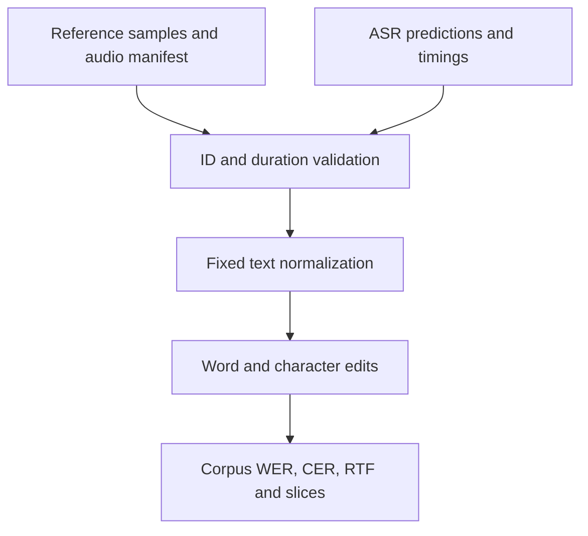

# ASR evaluation

Independent, model-free evaluation of saved ASR hypotheses. No inference or training.
Run from the repository root with an [ASR/TTS environment](../dataset-generator/asr-tts/README.md#installation) active.

## Architecture



## Ordinary metrics

```powershell
python -B evaluation/evaluate.py --dataset dataset-generator/asr-tts/src/runs/RUN/dataset --results dataset-generator/asr-tts/src/runs/RUN/whisper --output dataset-generator/asr-tts/src/runs/RUN/evaluation-whisper
```

- `--dataset`: directory with `samples.jsonl` and `audio_manifest.jsonl`.
- `--results`: directory with `predictions.jsonl` and `timings.jsonl`.
- `--output`: new output directory, never overwrites an existing evaluation.

Normalization: NFC, lowercase, ё→е, punctuation→spaces, collapsed whitespace.
CER includes spaces. Numbers, negations and words are not corrected. WER/CER
are corpus edit counts / corpus reference lengths; an empty denominator is null.
Outputs: `record_metrics.jsonl`, `summary.json`, `report.md`, including input hashes.

## Numeric diagnostic

```powershell
python -B evaluation/evaluate_numeric.py --dataset dataset-generator/asr-tts/src/runs/RUN/dataset --results dataset-generator/asr-tts/src/runs/RUN/whisper --baseline dataset-generator/asr-tts/src/runs/RUN/evaluation-whisper --output dataset-generator/asr-tts/src/runs/RUN/numeric-whisper
```

`--baseline` is the ordinary evaluation for the same exact input files. Other flags
have the meanings above. Supported numeric forms are canonicalized independently
for each text; unknown/ambiguous cases are flagged, never repaired from the reference.
Numeric scores have different denominators and do not replace ordinary metrics.

## Conditions and voices

```powershell
python -B evaluation/compare_conditions.py --dataset dataset-generator/asr-tts/src/runs/RUN/dataset --whisper dataset-generator/asr-tts/src/runs/RUN/evaluation-whisper --gigaam dataset-generator/asr-tts/src/runs/RUN/evaluation-gigaam --output dataset-generator/asr-tts/src/runs/RUN/comparison
```

`--whisper`/`--gigaam` point to ordinary evaluation directories, not raw predictions.
Outputs summarize voices, conditions, actions and splits. All generated files belong
in ignored `runs/`. Synthetic-speech results are not a human-speech benchmark.
